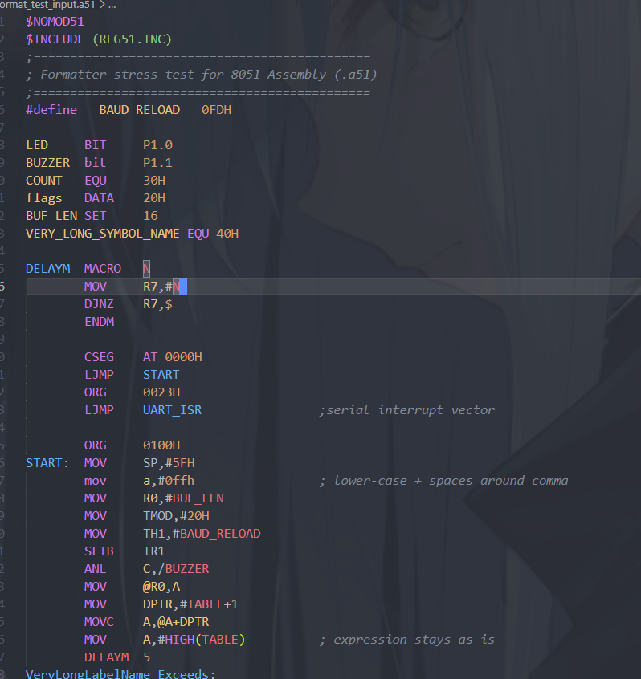

# 8051 Assembly (A51)

Syntax highlighting, formatting, diagnostics, hover reference, and IntelliSense for 8051 (MCS-51) assembly in the Keil A51 dialect, for `.asm` and `.a51` files.



## Features

### Syntax highlighting

TextMate-grammar highlighting for instructions, directives, registers, SFRs/SFR bits, bit addresses, numeric literals (hex/binary/octal/decimal), string literals, `$`/`#` compiler-control lines, and labels/symbol/macro definitions.

### Formatting

Format Document and Format Selection align labels, mnemonics, operands, and trailing comments into configurable columns:

```asm
; before
loop1: setb led
lcall delay ; go

; after (Format Document)
loop1:  setb    led
        lcall   delay                   ; go
```

- Content after a top-level `END` is left byte-for-byte untouched.
- Formatting is idempotent: formatting an already-formatted file is a no-op.
- Case normalization (if enabled) only ever touches mnemonics, directives, and known registers — your own label and symbol names are never rewritten.

See [Extension Settings](#extension-settings) for the full list of formatting options.

### Diagnostics

Lightweight, real-time checks as you type:

- Unknown instruction or directive
- Wrong number of operands for a known instruction
- A branch/call target that doesn't resolve to any label in the file
- Invalid indirect addressing (`@R2`-`@R7` — only `@R0`/`@R1` are addressable)
- Unmatched or never-closed `MACRO`/`IF`/`REPT`/`WHILE` blocks
- A symbol (label, `EQU`, `BIT`, `DATA`/`IDATA`/`XDATA`/`CODE`/`SEGMENT`, or macro) defined more than once

Like formatting, diagnostics stop at a top-level `END` — nothing after it is real code, so nothing after it is checked.

This is a lightweight checker, not a full assembler: it won't catch every semantic error a real A51 build would, and it does not assemble or simulate your code.

### Hover reference

Hovering an instruction shows its opcode(s), byte length, cycle count, affected flags, and an addressing-mode-specific explanation, plus relevant notes (e.g. the `ACALL`/`AJMP` same-page restriction, relative-jump range, `@Ri` indirect RAM range, `RETI` vs. `RET`).

### IntelliSense

- Auto-completion for instructions, directives, registers, and every symbol defined in the current file
- Go to Definition for labels, constants, and macros
- Find All References
- Outline / breadcrumbs (document symbols) for labels, constants, and macros
- Code folding for `MACRO`/`IF`/`REPT`/`WHILE` blocks

### Localization

Diagnostics messages, hover reference text, and completion details follow VS Code's display language: English, Simplified Chinese (简体中文), and Traditional Chinese (繁體中文) are all supported.

## Requirements

None — this extension only provides editor tooling (highlighting, formatting, diagnostics, IntelliSense). It does not assemble, build, or simulate your code, so no external toolchain is required.

## Extension Settings

| Setting                       | Default    | Description                                                                                                                                                                                        |
| ----------------------------- | ---------- | -------------------------------------------------------------------------------------------------------------------------------------------------------------------------------------------------- |
| `a51.format.mnemonicColumn`   | `8`        | Column where the mnemonic/directive starts.                                                                                                                                                        |
| `a51.format.operandColumn`    | `16`       | Column where the operand field starts.                                                                                                                                                             |
| `a51.format.commentColumn`    | `40`       | Column where trailing line comments start.                                                                                                                                                         |
| `a51.format.indentStyle`      | `spaces`   | Whitespace character used to reach each column (`spaces` or `tabs`).                                                                                                                               |
| `a51.format.tabSize`          | `8`        | Tab stop width used when `indentStyle` is `tabs`.                                                                                                                                                  |
| `a51.format.longLabelStyle`   | `newline`  | How to handle a label too long to fit before the mnemonic column: put the instruction on its own following line (`newline`), or keep it on the same line separated by a single space (`sameLine`). |
| `a51.format.caseStyle`        | `preserve` | Case normalization for mnemonics, directives, and known registers (`preserve`, `upper`, or `lower`). User-defined label/symbol names are never changed.                                            |
| `a51.format.commaSpacing`     | `preserve` | Whether to normalize operand lists to have exactly one space after each comma (`preserve` or `space`).                                                                                             |
| `a51.format.semicolonSpacing` | `preserve` | Whether to normalize trailing comments to have exactly one space after `;` (`preserve` or `space`).                                                                                                |
| `a51.format.indentMacroBody`  | `false`    | Indent one extra level inside `MACRO`/`ENDM`, `IF`/`ENDIF`, `REPT`/`ENDM`, and `WHILE`/`ENDW` blocks.                                                                                              |
| `a51.format.maxBlankLines`    | `1`        | Maximum number of consecutive blank lines to keep.                                                                                                                                                 |

## Known Issues

- Diagnostics are a heuristic, line-based checker rather than a full A51 assembler, so some real assembler errors may go unreported and some unusual-but-valid code may be flagged.

Found a bug or have a feature request? Please [open an issue](https://github.com/qmkc/vscode-8051-asm-lang/issues).

## Release Notes

See [CHANGELOG.md](https://github.com/qmkc/vscode-8051-asm-lang/blob/main/CHANGELOG.md).

## License

[MIT](https://github.com/qmkc/vscode-8051-asm-lang/blob/main/LICENSE)
